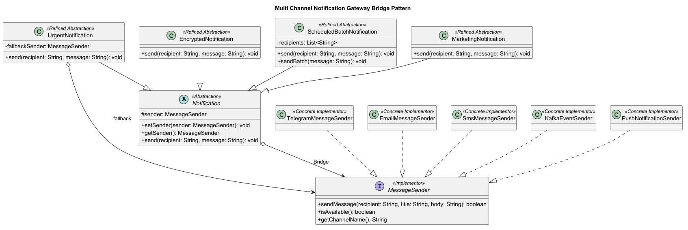

# Multi-Channel Notification Gateway

## Overview

This project is a Java application that demonstrates the Bridge design pattern.

The system separates notification types from message delivery providers. This allows both parts of the application to be extended independently.

All message providers are simulated. Real external APIs are not used.

## Technologies

- Java 17
- Maven
- JUnit 5
- PlantUML

## Bridge Pattern Structure

### Abstraction

`Notification` is the base abstraction. It contains a reference to a `MessageSender`.

### Refined Abstractions

- `UrgentNotification`
- `EncryptedNotification`
- `ScheduledBatchNotification`
- `MarketingNotification`

### Implementor

`MessageSender` is the implementor interface.

### Concrete Implementors

- `TelegramMessageSender`
- `EmailMessageSender`
- `SmsMessageSender`
- `KafkaEventSender`
- `PushNotificationSender`

## Main Features

- Urgent notifications with an `[URGENT]` prefix
- Fallback provider when the primary provider is unavailable
- Base64 message transformation
- Batch notifications for multiple recipients
- Batch delivery summary
- Runtime provider switching
- SMS limit of 160 characters
- Simulated Telegram, Email, SMS, Kafka and Push providers

## Mandatory Demonstration

The `Main` class demonstrates:

1. `UrgentNotification` with Telegram
2. `EncryptedNotification` with Email
3. `ScheduledBatchNotification` with SMS
4. Runtime switching from Telegram to Email
5. Unavailable Telegram with fallback to SMS
6. `MarketingNotification` with `PushNotificationSender`
7. Additional Kafka event publishing

## UML Class Diagram



## Running the Application

Run the following class from IntelliJ IDEA:

```text
src/main/java/com/example/notificationgateway/Main.java
```

Alternatively, compile the project with Maven:

```bash
mvn clean test
```

## Unit Tests

The project contains 11 JUnit 5 tests.

The tests cover:

- successful delivery;
- unavailable provider;
- fallback provider;
- SMS length restriction;
- encrypted message;
- batch notification;
- runtime sender switching;
- Push Notification provider;
- Marketing Notification;
- failure when all providers are unavailable.

## Bridge Pattern Questions

### 1. What are the two independent dimensions?

The two independent dimensions are notification types and message delivery providers.

Notification types define what should happen to a message. Delivery providers define how the message is delivered.

### 2. Where exactly is the Bridge?

The Bridge is the `MessageSender sender` field inside the abstract `Notification` class.

The `Notification` abstraction communicates with message providers through the `MessageSender` interface.

### 3. Why is inheritance problematic here?

Inheritance would require a separate class for every combination of notification type and provider.

Examples would include:

- `UrgentTelegramNotification`
- `UrgentEmailNotification`
- `EncryptedTelegramNotification`
- `EncryptedEmailNotification`

With N notification types and M providers, the system could require N × M classes.

### 4. What happens when a new provider is added?

A new class implements the `MessageSender` interface.

Existing notification classes do not need to be changed. For example, `PushNotificationSender` was added without modifying the notification hierarchy.

### 5. What happens when a new Notification type is added?

A new class extends the abstract `Notification` class.

Existing message providers do not need to be changed. For example, `MarketingNotification` works with Telegram, Email, SMS, Kafka and Push.

### 6. Why is this Bridge rather than Adapter?

Bridge separates two dimensions of the system so they can evolve independently.

Adapter is normally used to convert an existing incompatible interface into an interface expected by the client.

This project does not convert an incompatible interface. It connects notification types and delivery providers through a planned abstraction.

## Conclusion

The Bridge pattern prevents a large number of combination classes. New notification types and new message providers can be added independently without modifying the existing hierarchy.